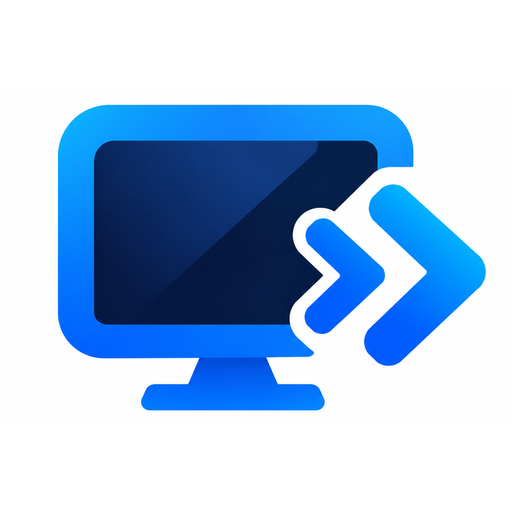
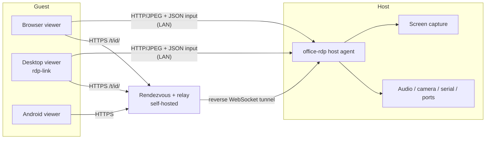

<p align="center">
  
</p>

<h1 align="center">RDP Link</h1>

<p align="center">
  <strong>Self-hosted, cross-platform remote desktop for macOS, Linux, Windows and Android.</strong><br/>
  Share a screen, control another machine, move files and forward devices — over your LAN or your own relay.
</p>

<p align="center">
  Built and maintained by
  <a href="https://www.eminentailabs.com"><strong>Eminent AI Labs Pvt. Ltd.</strong></a>
</p>

<p align="center">
  <a href="LICENSE"></a>
  
  
  
  
  <a href="https://www.eminentailabs.com"></a>
</p>

<p align="center">
  <a href="#downloads-v020">Download</a> ·
  <a href="#quick-start">Quick start</a> ·
  <a href="#how-it-works">How it works</a> ·
  <a href="#security-model">Security</a> ·
  <a href="#build-from-source">Build</a> ·
  <a href="#license--disclaimer">License</a>
</p>

---

RDP Link connects two devices directly, or through a rendezvous/relay server you
run yourself. A host agent captures the screen and serves it as JPEG frames over
HTTP; guests render those frames, send input events back, and optionally use
clipboard, file transfer, audio, camera, serial and TCP port forwarding.

It is deliberately simple to deploy: a single Go binary on the host, a browser
or a small desktop app on the guest, and no cloud account. It is **not** a
Microsoft RDP server and does not implement the RDP wire protocol — the name
refers to the product, not to Microsoft's protocol.

> **Project status — 0.2.1.** LAN and relay flows are implemented and validated
> end to end. The remaining gaps are external: Apple Developer ID
> notarization, Windows Authenticode, real-hardware Windows capture, macOS
> camera/USB kernel extensions and store publishing. See
> [Known limitations](#known-limitations) and [`docs/VALIDATION.md`](docs/VALIDATION.md).

## Built by Eminent AI Labs

RDP Link is designed, developed and maintained by
**[Eminent AI Labs Pvt. Ltd.](https://www.eminentailabs.com)** — an independent
software company building practical, self-hostable tools.

| | |
| --- | --- |
| **Company** | Eminent AI Labs Pvt. Ltd. |
| **Website** | [www.eminentailabs.com](https://www.eminentailabs.com) |
| **Product** | RDP Link (this repository) |
| **Platforms** | macOS · Linux · Windows · Android |
| **License** | MIT — free and open source |
| **Support** | Use the contact details on the company website for business, partnership, security or commercial-support enquiries. |

The company owns the release signing key used for the Android build and
maintains the CI, packaging and validation process described in this document.
RDP Link is also released as open source under the MIT license, so you can fork,
audit, self-host and redistribute it under the terms in [`LICENSE`](LICENSE).

## Table of contents

- [Built by Eminent AI Labs](#built-by-eminent-ai-labs)
- [Downloads](#downloads-v020)
- [Features](#features)
- [How it works](#how-it-works)
- [Quick start](#quick-start)
- [Install per platform](#install-per-platform)
- [Headless CLI (no GUI)](#headless-cli-no-gui)
- [Device bridge](#device-bridge)
- [Security model](#security-model)
- [Command line](#command-line)
- [Build from source](#build-from-source)
- [Testing](#testing)
- [Validation status](#validation-status)
- [Project layout](#project-layout)
- [Troubleshooting](#troubleshooting)
- [Known limitations](#known-limitations)
- [FAQ](#faq)
- [Open-source compliance](#open-source-compliance)
- [Contributing](#contributing)
- [License & disclaimer](#license--disclaimer)
- [Acknowledgements](#acknowledgements)

## Downloads (v0.2.1)

Pick your operating system. Every file below is stored in the
[`releases/`](releases/) folder of this repository, so the links work directly
from GitHub — download, install, connect.

| Operating system | Package | How to install |
| --- | --- | --- |
| **macOS** (Apple silicon + Intel) | [`RDPLink-macos.dmg`](releases/RDPLink-macos.dmg) · 46 MB | Open the DMG, drag **RDP Link** into **Applications**. |
| **macOS** (installer) | [`RDPLink-installer.pkg`](releases/RDPLink-installer.pkg) · 41 MB | Double-click; the postinstall adds the firewall rule and login service. |
| **Windows** 10/11 (x86-64) | [`RDPLink-setup.exe`](releases/RDPLink-setup.exe) · 22 MB | Run the installer. It ships the launcher, host agent and rendezvous server. |
| **Linux** (arm64) | [`rdplink-linux-arm64.deb`](releases/rdplink-linux-arm64.deb) · 23 MB | `sudo dpkg -i rdplink-linux-arm64.deb` |
| **Linux** (x86-64) | [`rdplink-linux-amd64.deb`](releases/rdplink-linux-amd64.deb) · 24 MB | `sudo dpkg -i rdplink-linux-amd64.deb` |
| **Linux** (portable, both arches) | [`rdplink-linux.tar.gz`](releases/rdplink-linux.tar.gz) · 74 MB | Extract and run `rdp-link` or `office-rdp` directly. |
| **Android** 10+ (API 29+) | [`RDPLink-android-release.apk`](releases/RDPLink-android-release.apk) · 49 MB | Sideload the APK (allow "Install unknown apps" for your file manager). |
| **Android** (Play upload) | [`RDPLink-android-release.aab`](releases/RDPLink-android-release.aab) · 19 MB | Upload bundle for Google Play. |

Every desktop package includes the **headless `rdp-link` CLI** and the
`office-rdp` agent — share, connect, capture a screenshot, read the clipboard or
send input entirely from a terminal, with no GUI or X server. On macOS the
`.pkg` installs `/usr/local/bin/rdp-link`, the `.dmg` app exposes
`Contents/MacOS/rdp-link` (`--install-cli` links it), and the Windows installer
adds `C:\Program Files\RDP Link` to `PATH`. See
[Headless CLI](#headless-cli-no-gui). The same flags work on macOS and Windows.

### Verify your download

Every release file has a SHA-256 checksum in
[`releases/SHA256SUMS`](releases/SHA256SUMS). Verify before installing:

```sh
cd releases
shasum -a 256 -c SHA256SUMS        # macOS / Linux
# certutil -hashfile RDPLink-setup.exe SHA256   # Windows (compare manually)
```

<details>
<summary>SHA-256 checksums for 0.2.1</summary>

```text
4094fa36600f63acb23473b3f25b0f9893bb05e5833ff0317021bbee28317aef  LICENSE
2e026d69ae006fc4e1b35e89b62c9c74edc50d89cbf118b08ee0abe4b31f015f  RDPLink-android-release.aab
be3579fc484d1761dd77b098d88cc655cb038059321ca36e360239c9770da6d9  RDPLink-android-release.apk
3cf9de56c26fb1a33ebac25db40ea8efb8ac079cf61e0df520de1743c2e5e2af  RDPLink-installer.pkg
8ed74c50cf44a1f562677f0a9e38634f1699e42a73ea85320e1b3137ceae6d41  RDPLink-macos.dmg
a5d0fa6d4c4552523832dda2e933493fea1f3531f598060b9bf13651909a9ec8  RDPLink-setup.exe
79c69073d330840bbbe6531957acf4e36b348569e1fc56ea59e3ab0e1bb627b1  THIRD_PARTY_NOTICES.md
834dfc67f6673bf4f206d8e6ee8d6174e4c5be721959706c04e13c93b8a938fc  rdplink-linux-amd64.deb
d1fcc1af58b265f819b39698e6d87e41473cac52161cdfe60c7af1891eceb439  rdplink-linux-arm64.deb
ad939773fc4878e9946ca3ac90587d7cc1182fe901ab2bf4aea5d7e8c775817a  rdplink-linux.tar.gz

</details>

### Signing and provenance

| Platform | Signing status | Details |
| --- | --- | --- |
| macOS | Ad-hoc signed | `codesign --verify --strict` passes on the `.app`; DMG checksum verifies. Developer ID signing and notarization need an Apple account. |
| Windows | Not signed | Authenticode requires a Windows code-signing certificate; the CI pipeline signs automatically when `WINDOWS_CERT_BASE64` is configured. |
| Linux | Not signed | `.deb` packages are built reproducibly by `packaging/build-linux-deb.sh`; distro repository signing is out of scope. |
| Android | Release-signed | `CN=Office RDP, O=Eminent AI Labs, C=US`, SHA-256 `de7382e435ec0bddca7cb82ac456f9a316df83cfba56a7562124effbd4bc9283`. |

RDP Link itself has **no telemetry, no analytics and no cloud account**. It only
talks to the rendezvous server you configure (if any). See
[`docs/PRIVACY.md`](docs/PRIVACY.md).

## Features

| Area | What you get |
| --- | --- |
| **Screen sharing** | Adaptive JPEG frames with `ETag`/`304`, PNG fallback, multi-display selection, synthetic test pattern for CI/headless hosts. |
| **Input** | Mouse move, click, press/hold drag, right click, vertical/horizontal wheel, full keyboard with modifiers, touch gestures on Android. |
| **Display** | Fit, fill, 1:1 and 50–150 % scaling; portrait and landscape; scrollable canvas above native size. |
| **Identity** | Ed25519 device key, stable 9-digit RDP Link ID (`SHA-256(pubkey)`), human-friendly alias, signed rendezvous registration. |
| **LAN discovery** | mDNS (`_office-rdp._tcp`) plus direct `host:port`. |
| **WAN** | Self-hosted rendezvous + reverse WebSocket relay; guests connect to `https://relay/t/<id>/`. |
| **Clipboard** | Two-way text clipboard, with a Devices-drawer "send to host" and paste forwarding. |
| **Files** | Browse, upload and download with size limits, attachment headers and streamed transfers. |
| **Devices** | Speaker audio, microphone, camera preview, serial console, TCP port forwarding, USB storage sharing. |
| **Guests** | Desktop viewer (Tk), browser viewer, full-screen Android viewer. |
| **Hosts** | macOS, Linux (X11), Windows (GDI) and Android (MediaProjection). |
| **Headless CLI** | `rdp-link --share/--connect/--status/--probe/--save-frame/--clipboard-*` on macOS, Linux and Windows; no tkinter, no X server, works over SSH. |
| **Security** | Password header or `HttpOnly` session cookie, 2-minute read-only media tokens, brute-force throttling, origin checks, signed relay traffic with nonce replay protection. |
| **Packaging** | DMG/PKG, NSIS installer, `.deb` + tarball, signed APK/AAB, CI for every platform. |

## How it works



- The host agent (`office-rdp --host`) captures the screen and serves an HTTP
  API on port `8088` (configurable).
- Guests authenticate with the host password (`X-Office-Password`) or exchange
  it once at `POST /session` for an `HttpOnly`, `SameSite=Strict` cookie.
- Media players that cannot send headers use a short-lived, read-only media
  token from `POST /media-token`.
- For WAN, the host keeps an outbound WebSocket tunnel open to the rendezvous
  server; the relay proxies requests under `/t/<peer-id>/…`, so no inbound port
  is required.

The design and trade-offs are documented in
[`docs/ARCHITECTURE.md`](docs/ARCHITECTURE.md), [`docs/adr/`](docs/adr/) and
[`docs/WAN.md`](docs/WAN.md); development setup and contribution workflow are
in [`docs/DEVELOPMENT.md`](docs/DEVELOPMENT.md).

## Quick start

### 1. Share this screen (host)

```sh
office-rdp --host --port 8088
```

On first run the agent generates a random 24-byte password, stores it in
`~/.config/office-rdp/host-password` (`0600`) and prints the path — never the
password itself. Pin your own with `--password` or `--password-file`, and check
the environment with:

```sh
office-rdp --doctor          # display, capture backend, port, identity
office-rdp --displays
office-rdp --id              # 9-digit RDP Link ID
```

### 2. Connect from a guest

| Guest | Command / action |
| --- | --- |
| Desktop app | Launch `rdp-link`, choose **Connect to a device**, enter `host:port` or the 9-digit ID, then the password. |
| Desktop viewer directly | `cd app && python3 office_viewer.py http://HOST:8088 --password 'PW'` |
| Browser | Open `http://HOST:8088/` and type the password in the page. |
| Android | Enter `host:port` (or the 9-digit ID when a rendezvous is configured) and tap **Connect**. |

Headless alternative (SSH, container, no display):

```sh
rdp-link --share --port 8088                     # host, no GUI
rdp-link --connect HOST:8088 --password-file FILE --probe
rdp-link --connect HOST:8088 --save-frame shot.jpg
```

### 3. Connect over the internet (optional)

```sh
# On a server you control
office-rdp-rendezvous --listen :8080 --public-url https://relay.example.com

# On the host
office-rdp --host --port 8088 --rendezvous https://relay.example.com
```

Guests then use `https://relay.example.com/t/<9-digit-id>/`. Put the relay
behind TLS (or pass `--tls-cert` / `--tls-key`) before exposing it. See
[`docs/WAN.md`](docs/WAN.md).

The relay is lightweight (1 vCPU, ~256 MB RAM, minimal disk). The main cost
is **bandwidth**. Free options include Oracle Cloud Always Free, Tailscale
(personal), Cloudflare Tunnel, and other open-source tunnels — see
`docs/WAN.md` §9–§10.

### How WAN works with dynamic IPs

The host never needs a public IP. It derives a stable 9-digit **peer ID** from
its Ed25519 device key and keeps an **outbound** WebSocket tunnel open to the
relay. Guests connect using the peer ID and the relay's stable URL; the relay
proxies requests over that tunnel. If the host's IP changes, it reconnects
automatically — the guest never notices. See `docs/WAN.md` §7 for the full
flow and diagrams.

### Lightweight telemetry monitor

A password-protected dashboard tracks the relay server's health, services, and
hardware resources:

- **URL:** `https://monitor.130-210-56-200.sslip.io`
- **Auth:** HTTP Basic Auth (`admin` / password set by the operator).
- **Resource use:** ~12 MB RAM, negligible CPU.

See `docs/WAN.md` §12 for details.

### Public relay (provided as-is, best effort)

A convenience relay is currently available at:

    https://relay.130-210-56-200.sslip.io

You may use it for WAN connections and testing. **This relay is operated by the
project maintainer on a best-effort basis and is subject to change, rate
limiting, or removal at any time without notice. No uptime, availability, or
data-durability guarantees are provided. Use it at your own risk.** For
production, privacy-sensitive, or high-availability use, run your own relay —
see `docs/WAN.md` (including the Oracle Cloud deployment guide in §11).

### Testing a public path with `cloudflared`

For quick internet testing without a domain or TLS setup, use a Cloudflare
quick tunnel:

```sh
cloudflared tunnel --url http://127.0.0.1:8088
# → https://random-words-1234.trycloudflare.com
```

This is **testing only** — the URL is temporary. For production, self-host
`office-rdp-rendezvous` with TLS. See `docs/WAN.md` §8.

## Install per platform

### macOS

1. Open `RDPLink-macos.dmg` and drag **RDP Link** into **Applications**.
   (The `.pkg` installs the same app and adds a login service.)
2. Launch it and grant, when asked:
   - **Screen Recording** — required to capture the screen.
   - **Accessibility** — required to send keyboard and mouse input.
   - **Camera** / **Microphone** — only if you enable those devices.
3. The agent runs as your user; the app shows the RDP Link ID, LAN/WAN address
   and sharing state.

The build is ad-hoc signed. If Gatekeeper blocks the DMG, right-click →
**Open**, or run `xattr -dr com.apple.quarantine "/Applications/RDP Link.app"`.
A Developer ID + notarized build removes this step once an Apple account is
available (see [`docs/MAC-SIGNING-NOTARIZATION.md`](docs/MAC-SIGNING-NOTARIZATION.md)).

### Windows

1. Run `RDPLink-setup.exe`. It installs to `C:\Program Files\RDP Link`, adds a
   Start-menu shortcut, an uninstaller and a firewall rule for the agent port.
2. Launch **RDP Link** and grant screen-capture access if Windows asks.
3. The Go agent uses GDI capture and `robotgo` input; no Python is required on
   the target machine.

The installer and `.exe` files are unsigned until an Authenticode certificate is
configured. CI signs automatically when the certificate secrets are present.

### Linux

```sh
sudo dpkg -i rdplink-linux-amd64.deb     # or -arm64.deb
```

The package installs `office-rdp`, `office-rdp-rendezvous`, `rdp-link` and the
docs, loads the `uinput`/`v4l2loopback` modules when available, and adds the
`uinput` udev rule. Run the host as your desktop user:

```sh
office-rdp --host --port 8088
```

- **X11** is supported directly (validated on Ubuntu 24.04).
- **Wayland** needs an XWayland session, or a portal-based capture backend
  (tracked as future work).
- The portable tarball works without `dpkg`:

```sh
tar xzf rdplink-linux.tar.gz
./rdp-link
```

### Android

1. Sideload `RDPLink-android-release.apk` (enable installs from your file
   manager).
2. Open **RDP Link** → **Share this device** → allow the screen-capture prompt.
3. For remote input, enable the **RDP Link input** accessibility service in
   Android settings (Settings → Accessibility). Without it, guests can view but
   not control.
4. The Android host can also open a relay tunnel, so it is reachable over WAN
   with the same 9-digit ID.

Minimum: Android 10 (API 29). Target: Android 16 (API 36).

## Headless CLI (no GUI)

`rdp-link` is also a full command-line client. It never imports tkinter, so it
works over SSH, in a container, or on a server with no display. The same flags
work on Linux, macOS and Windows.

### Install the command

| Platform | How `rdp-link` gets on PATH |
| --- | --- |
| **Linux `.deb`** | Preinstalled as `/usr/bin/rdp-link` (also `office-rdp` and `office-rdp-rendezvous`). |
| **Linux tarball** | `./rdp-link --install-cli` writes a wrapper to `/usr/local/bin` or `~/.local/bin`. |
| **macOS `.pkg`** | The postinstall writes `/usr/local/bin/rdp-link`, `office-rdp` and `office-rdp-rendezvous`. |
| **macOS `.dmg`** | Run `"/Applications/RDP Link.app/Contents/MacOS/rdp-link" --install-cli`. |
| **Windows installer** | Adds `C:\Program Files\RDP Link` to the system `PATH`; open a new terminal. |
| **Any platform** | `rdp-link --install-cli` / `rdp-link --uninstall-cli` (macOS/Linux wrappers, Windows user `PATH`). |

`--install-cli` is idempotent. On macOS/Linux it prefers `/usr/local/bin` and
falls back to `~/.local/bin`; set `RDPLINK_CLI_BIN` to choose another directory.
On Windows it edits the per-user `PATH` (no admin prompt) and broadcasts the
environment change.

```sh
# macOS (DMG install, one-time)
"/Applications/RDP Link.app/Contents/MacOS/rdp-link" --install-cli
rdp-link --version

# Windows (PowerShell), for a portable copy or if PATH is not set yet:
& "C:\Program Files\RDP Link\rdp-link.exe" --install-cli
rdp-link --version
```

```sh
# Who am I?
rdp-link --id                     # 9-digit RDP Link ID
rdp-link --status                 # ID, alias, identity path, agent version
rdp-link --status --json

# Share this screen, headless (Ctrl-C to stop)
rdp-link --share --port 8088
rdp-link --share --port 8088 --password-file ~/.config/office-rdp/host-password
rdp-link --share --read-only --rendezvous https://relay.example.com
rdp-link --share --test-pattern   # synthetic frames, no screen permission

# Connect and verify a host (no GUI)
rdp-link --connect 192.168.1.20:8088 --password-file ~/.config/office-rdp/host-password
rdp-link --connect https://relay.example.com/t/123456789/
rdp-link --connect 123456789 --rendezvous https://relay.example.com

# Headless actions against the connected host
rdp-link --connect HOST --probe                  # fetch one frame, print size
rdp-link --connect HOST --save-frame shot.jpg    # save a screenshot
rdp-link --connect HOST --clipboard-get
rdp-link --connect HOST --clipboard-set "text"
rdp-link --connect HOST --click 640,400          # click at remote coordinates
rdp-link --connect HOST --type "hello"           # type text
rdp-link --connect HOST --key enter

# Diagnostics and discovery
rdp-link --doctor
rdp-link --displays
rdp-link --peers --rendezvous https://relay.example.com

# Legacy FreeRDP profile manager (still available)
rdp-link --list
rdp-link --connect-profile "Profile Name"
```

| Flag | Meaning |
| --- | --- |
| `--connect TARGET` | Peer ID (needs `--rendezvous`), `host:port`, or an `http(s)` URL. A matching legacy profile name is connected through FreeRDP instead. |
| `--password` / `--password-file` | Credentials; a file keeps the password out of the process list. `RDPLINK_PASSWORD` also works. |
| `--probe` | Fetch `/frame.jpg` (or PNG fallback) and print bytes + dimensions. |
| `--save-frame PATH` | Write one frame; the extension defaults from the content type. |
| `--clipboard-get`, `--clipboard-set TEXT` | Read or write the host clipboard. |
| `--click X,Y`, `--type TEXT`, `--key KEY` | Send input without a viewer. |
| `--open` | Additionally launch the GUI viewer (opt-in). |
| `--json` | Machine-readable output for scripts and monitoring. |
| `--share` | Run the host agent headless; `--port`, `--display`, `--read-only`, `--test-pattern`, `--rendezvous`, `--relay-*` apply. |
| `--doctor`, `--displays`, `--peers` | Delegate to the Go agent's diagnostics/registry commands. |
| `--list`, `--connect-profile` | Legacy FreeRDP profiles (unchanged). |
| `--install-cli`, `--uninstall-cli` | Put `rdp-link`/`office-rdp` on PATH (wrappers on macOS/Linux, user PATH on Windows). |
| `--help`, `--version` | Usage / version, no GUI import. |

Exit codes: `0` success, `1` connection/authentication/runtime failure, `2`
usage error. `--connect` prints the resolved URL, peer ID, alias and addresses
(and JSON with `--json`), so it doubles as a health check in scripts.

Example monitoring loop:

```sh
while sleep 30; do
  rdp-link --connect 123456789 --rendezvous https://relay.example.com \
           --password-file ~/.config/office-rdp/host-password --json \
    || echo "host unreachable at $(date)"
done
```

## Device bridge

Devices are **off by default** and require the host password. Availability is
reported by `GET /capabilities`.

| Feature | Endpoint | Host flag | Over relay |
| --- | --- | --- | --- |
| Speaker (host → guest) | `GET /audio` (WebM/Opus) | `--audio-input` | Yes |
| Microphone (guest → host) | `WS /mic` | built in (`ffplay`) | LAN only |
| Camera preview (host → guest) | `GET /camera.mjpg` | `--camera-device` | Yes |
| Serial console | `WS /serial` | `--serial` | LAN only |
| TCP port forwarding | `/port/<port>/…` | `--forward` | Yes |
| File / USB storage sharing | `/files`, `/upload`, `/download` | built in | Yes |
| Virtual camera (guest → host apps) | `--virtual-camera` (Linux) | `v4l2loopback` | LAN |

Examples:

```sh
# Speaker: PulseAudio/PipeWire monitor source
office-rdp --host --audio-input pulse:default

# Camera: index on macOS/Windows, device path on Linux, or a test source
office-rdp --host --camera-device 0
office-rdp --host --camera-device /dev/video0
office-rdp --host --camera-device testsrc

# Serial over USB or TCP
office-rdp --host --serial /dev/tty.usbserial-1420
office-rdp --host --serial tcp:192.168.1.50:4001

# Forward selected host ports to guests
office-rdp --host --forward 9099,5432
```

Full details, platform notes and browser/Android caveats are in
[`docs/DEVICES.md`](docs/DEVICES.md).

## Security model

- **No password in URLs.** The password is sent in `X-Office-Password` or
  exchanged at `POST /session` for an `HttpOnly`, `SameSite=Strict` cookie.
- **Scoped media tokens.** `POST /media-token` returns a token valid for two
  minutes that only opens the read-only media paths (`/frame.jpg`,
  `/frame.png`, `/stream.mjpg`, `/audio`, `/camera.mjpg`). A full session token
  is rejected in a query string.
- **Brute-force throttling** on the host and Android service, keyed by the real
  client address (`X-Forwarded-For` behind the relay).
- **Origin checks** on state-changing browser requests and on the relay proxy.
- **Signed rendezvous traffic.** Every registry/tunnel request is signed with
  the device's Ed25519 key; the signature covers method, URI, timestamp, nonce
  and body hash. Nonces and timestamps are checked, so captured requests cannot
  be replayed. The first key seen for a peer ID is pinned.
- **Bounded tables** for keys, pairings, peers, nonces and resolve throttles.
- **Cookie scoping** on the relay, so two tunnelled hosts cannot overwrite each
  other's session.

The full threat model and the hardening history are in
[`docs/SECURITY.md`](docs/SECURITY.md). Security issues should be reported
privately — see [`docs/SECURITY.md`](docs/SECURITY.md#reporting).

## Command line

### `rdp-link` (headless launcher)

The RDP Link CLI is documented in [Headless CLI](#headless-cli-no-gui). It
covers identity/status, headless sharing, connect/probe/screenshot, clipboard,
input and the legacy FreeRDP profiles. It does not import tkinter.

### `office-rdp`

| Flag | Purpose |
| --- | --- |
| `--host` | Run the host agent (screen sharing). |
| `--port N` | HTTP port (default `8088`). |
| `--display N` | Display index to capture (default `0`). |
| `--password`, `--password-file` | Pin the access password; the file keeps it out of the process list. |
| `--read-only` | View-only; remote input is rejected. |
| `--rendezvous URL` | Register with a rendezvous/relay server. |
| `--relay-insecure`, `--relay-ca` | Testing TLS overrides for the relay. |
| `--audio-input`, `--camera-device`, `--serial`, `--forward` | Device bridge. |
| `--virtual-camera`, `--usbip` | Linux virtual camera and USB/IP export. |
| `--record FILE` | Record the session to H.264. |
| `--ui` | Open the browser control panel. |
| `--connect ID\|URL` | Open the viewer for a peer ID (needs `--rendezvous`) or an `http(s)` URL. |
| `--id`, `--doctor`, `--displays`, `--version` | Diagnostics. |
| `--pair-code`, `--list`, `--list-peers`, `--admin-token` | Pairing and registry tools. |
| `--install-service` | Install the macOS LaunchAgent or systemd user service. |
| `--test-pattern` | Stream a synthetic pattern instead of the screen. |

### `office-rdp-rendezvous`

| Flag | Purpose |
| --- | --- |
| `--listen :8080` | Listen address. |
| `--public-url URL` | Public base URL used in relay links. |
| `--tls-cert`, `--tls-key` | Enable HTTPS/WSS. |
| `--admin-token` | Unlock LAN addresses in `/peers`. |

Run `office-rdp --help` / `office-rdp-rendezvous --help` for the full list.

## Build from source

**Requirements:** Go 1.26+, Python 3.12+ (launcher/viewer), and for packages:
Node-free tooling plus the platform SDKs listed below.

```sh
git clone https://github.com/MahajanTarun/RDP-Link.git
cd RDP-Link/RDP_Link_v2

# Go core and binaries
go build ./...
go test ./...

# Desktop launcher + viewer (Python/Tk)
cd app && python3 -m pip install pillow && python3 ubuntu_rdp_manager.py
# Pillow is optional (JPEG decoding); without it the viewer asks the host for PNG.
# app/requirements.txt lists the build/test tools (PyInstaller, pytest).
```

### Packages

| Target | Command | Extra requirements |
| --- | --- | --- |
| macOS DMG + PKG | `bash packaging/build-macos.sh && bash packaging/build-macos-pkg.sh` | Xcode command-line tools; Swift for the TCC helper |
| Windows installer | `bash packaging/build-windows-app-wine.sh && bash packaging/windows/build-installer.sh` | Wine (or run `packaging/build-windows.ps1` on Windows), MinGW-w64, NSIS |
| Linux `.deb` + tarball | `bash packaging/build-linux.sh && bash packaging/build-linux-deb.sh` | Docker (or native Go + `dpkg-deb`) |
| Android AAR | `bash packaging/build-android-core.sh` | Android NDK 29, `gomobile`, `gobind` |
| Android APK/AAB | `bash packaging/build-android-release.sh` | Android SDK 36 / JDK 17; keystore in `~/.config/officerdp/android-signing.env` |

CI builds all of the above in [`.github/workflows/ci.yml`](.github/workflows/ci.yml).

## Testing

```sh
bash scripts/test-all.sh        # go vet + go test + asset sync + pyflakes + pytest
go test -race ./...             # race detector
bash scripts/security-scan.sh   # gosec, govulncheck, shellcheck, license audit
bash scripts/license-audit.sh   # linked Go modules must all be permissive
```

Current state: **96 Python tests**, all Go packages pass, race detector clean,
security scan clean. The methodology, devices and reproducible commands are in
[`docs/TESTING.md`](docs/TESTING.md).

## Validation status

| Platform | Host | Guest |
| --- | --- | --- |
| macOS 27.2 (arm64) | **Live** — 1512×982 JPEG stream, ETag, input, session/media tokens. | **Live** — desktop viewer, browser, Android guest. |
| Linux (Ubuntu 24.04, X11) | **Live** — real X session at 1366×768; devices verified. | **Live** — desktop and browser viewers. |
| Windows (installer + app) | **Working under Wine** with a test pattern; real GDI capture needs Windows hardware. | **Live under Wine** — PyInstaller launcher, `--viewer --probe` returns a frame. |
| Android 16 (SM-S711B) | **Live** — MediaProjection, accessibility input, relay tunnel. | **Live** — full-screen viewer, camera/mic origin allowlist. |
| **Headless CLI** (macOS, Linux, Windows) | **Live** — `--share` starts the agent with no GUI; `--doctor/--displays/--peers` delegate. | **Live** — `--probe` returned a 25,060-byte 1280×800 frame, `--save-frame` wrote a JPEG, `--clipboard-set/get` round-tripped, and `--status --json` parsed; no tkinter loaded. |

Last validated: **2026-11-04**. Evidence, byte counts and per-flow notes live in
[`docs/VALIDATION.md`](docs/VALIDATION.md).

## Project layout

```text
RDP_Link_v2/
├── cmd/office-rdp/        host agent, viewer launcher and CLI
├── cmd/rendezvous/        rendezvous/relay server
├── core/                  identity, peers, peerauth, capture, input,
│                          clipboard, policy, host HTTP API, relay client
├── rendezvous/            registry, signed auth, reverse-tunnel proxy
├── mobile/                gomobile bindings (identity, signing, relay)
├── app/                   Python/Tk launcher, headless CLI, viewer, assets
├── android/               Kotlin host service, viewer, accessibility input
├── macos/                 TCC permission helper (Swift)
├── packaging/             macOS, Linux, Windows, Android build scripts
├── releases/              downloadable 0.2.1 artifacts + SHA256SUMS
├── tools/relay-monitor/   lightweight VPS telemetry dashboard
├── docs/                  security, setup, testing, validation, ADRs
└── scripts/               test-all, security-scan, asset sync, probes
```

## Troubleshooting

| Symptom | Fix |
| --- | --- |
| Browser shows 401 after typing the password | Check caps lock; the password is per host. Use `office-rdp --id` on the host to confirm you reached the right device. |
| macOS host shows a black frame | Grant **Screen Recording** to the app/terminal, then restart it. |
| No remote input on macOS | Grant **Accessibility** to **RDP Link** (or the terminal running `office-rdp --host`). |
| Windows host cannot capture under Wine | Expected: Wine has no GDI desktop. Use `--test-pattern`, or run on real Windows. |
| Microphone/camera blocked in the browser | Browsers require HTTPS or `localhost` for `getUserMedia`. Use the TLS relay URL. |
| `connect: --rendezvous is required` | Pass `--rendezvous https://…` when connecting by 9-digit ID. |
| Android viewer can't control | Enable the **RDP Link input** accessibility service. |
| Relay says `signature required` | Clients and server must be rebuilt together when the signing format changes; update both. |

More in [`docs/TROUBLESHOOTING.md`](app/docs/TROUBLESHOOTING.md) and
[`docs/SETUP.md`](docs/SETUP.md).

## Known limitations

- **Not Microsoft RDP compatible.** It is a purpose-built HTTP/JPEG protocol.
- **Windows capture** is validated under Wine only; real hardware is pending.
- **Wayland** requires XWayland; no portal capture backend yet.
- **Microphone and serial** are LAN-only; the relay carries HTTP streams, not
  arbitrary WebSockets.
- **Camera** is a preview, not a virtual camera in host apps on macOS/Windows
  (Linux has `--virtual-camera`).
- **USB** is storage-level file sharing, not generic USB passthrough.
- **Signing**: no Apple Developer ID, no Windows Authenticode, no distro
  repository signing.
- **Stores**: Play/F-Droid publication needs accounts and review.

## FAQ

**Is this a fork of RDP or FreeRDP?**
No. RDP Link is a separate product with its own protocol. The desktop launcher
also contains the legacy v4.5 FreeRDP profile manager, but the RDP Link agent
and viewer do not speak the RDP protocol.

**Do I need a cloud account?**
No. LAN mode needs nothing. WAN mode needs a rendezvous server you host (or
someone hosts for you).

**Is my traffic encrypted?**
Direct LAN traffic is HTTP by default (encrypt it with a TLS-terminating proxy
or use the relay with TLS). Relay traffic is HTTPS/WSS when the relay has a TLS
certificate. Screen frames and input are never sent anywhere except between the
two peers and the relay you configure.

**Can two people use the same host at once?**
Yes — the browser viewer supports multiple guests; input is shared. Use
`--read-only` for view-only sessions.

**Does it work on phones?**
Yes. Android can host and be a guest; any phone browser can be a guest.

## Open-source compliance

RDP Link is MIT-licensed and ships only permissively licensed third-party code
(**MIT, BSD-2-Clause, BSD-3-Clause and Apache-2.0**). No GPL, LGPL or AGPL code
is linked into the shipped binaries.

[`THIRD_PARTY_NOTICES.md`](THIRD_PARTY_NOTICES.md) records every component, its
exact version, the license it is used under, and reproduces the full license
texts that must accompany a binary distribution.

- **Linked components** include robotgo (Apache-2.0), Pion `mediadevices` and
  WebRTC (MIT), `gorilla/websocket` (BSD-2-Clause), `hashicorp/mdns` (MIT),
  `kbinani/screenshot` (MIT), `jezek/xgb` (BSD-3-Clause), `golang.org/x/*`
  (BSD-3-Clause), OpenH264 (BSD-2-Clause), NanoHTTPD (BSD-3-Clause), Kotlin
  (Apache-2.0), Python (PSF-2.0), Tcl/Tk, Pillow (HPND) and PyInstaller
  (GPL-2.0-or-later **with Bootloader Exception**).
- **PyInstaller** is a build tool. Its Bootloader Exception expressly permits
  distributing a frozen application without applying the GPL to that
  application; RDP Link does not modify PyInstaller.
- **Not bundled:** FFmpeg/ffplay, v4l2loopback, usbip, BlackHole/Loopback and
  Tesseract. They are optional, user-installed programs invoked as separate
  processes, so their licenses do not extend to RDP Link.
- **Original assets:** the RDP Link name, logo, app icons and UI are owned by
  Eminent AI Labs Pvt. Ltd. No third-party fonts, icon packs or UI framework
  code (including Ant Design) are shipped.
- **Redistribution:** keep [`LICENSE`](LICENSE) and
  [`THIRD_PARTY_NOTICES.md`](THIRD_PARTY_NOTICES.md) with every copy. The
  installers bundle both files, and they sit next to the downloads in
  [`releases/`](releases/).

## Contributing

Issues and pull requests are welcome.

1. Fork the repository and create a topic branch.
2. Keep the Go core formatted (`gofmt`) and run `bash scripts/test-all.sh`.
3. Add a test for behavior changes; keep platform-specific code behind build
   tags or interfaces.
4. Update the relevant doc in `docs/` when you change a flow.
5. Describe the platform(s) you tested on in the PR.

Please do not include real passwords, private keys or user screen captures in
issues.

## License & disclaimer

RDP Link is released under the **MIT License** — free to use, copy, modify,
merge, publish, distribute, sublicense and sell, for personal or commercial
work, provided the copyright notice and permission notice are retained.

Copyright © 2026 **Eminent AI Labs Pvt. Ltd.** and RDP Link contributors.

See [`LICENSE`](LICENSE) for the full text.

```text
MIT License — Copyright (c) 2026 Eminent AI Labs Pvt. Ltd. and RDP Link contributors

THE SOFTWARE IS PROVIDED "AS IS", WITHOUT WARRANTY OF ANY KIND, EXPRESS OR
IMPLIED, INCLUDING BUT NOT LIMITED TO THE WARRANTIES OF MERCHANTABILITY,
FITNESS FOR A PARTICULAR PURPOSE AND NONINFRINGEMENT. IN NO EVENT SHALL THE
AUTHORS OR COPYRIGHT HOLDERS BE LIABLE FOR ANY CLAIM, DAMAGES OR OTHER
LIABILITY, WHETHER IN AN ACTION OF CONTRACT, TORT OR OTHERWISE, ARISING FROM,
OUT OF OR IN CONNECTION WITH THE SOFTWARE OR THE USE OR OTHER DEALINGS IN THE
SOFTWARE.
```

### Use at your own risk

RDP Link grants remote control of a computer. You are solely responsible for:

- who you share a password or RDP Link ID with;
- the network exposure of the host port and any relay you operate;
- backing up data before enabling file transfer, port forwarding or device
  redirection;
- complying with the laws, policies and consent requirements that apply where
  you use it.

The authors and contributors accept **no liability** for data loss, unauthorized
access, service interruption or any other damage arising from use of this
software. Run it on networks and devices you own or are authorized to control.

### Third-party components

RDP Link builds on open-source projects including Go, Pion `mediadevices`,
`kbinani/screenshot`, `robotgo`, `gorilla/websocket`, `golang.org/x/mobile`,
NanoHTTPD, Kotlin, Python/Tk and Pillow. Their licenses apply to those
components; see [`THIRD_PARTY_NOTICES.md`](THIRD_PARTY_NOTICES.md) for the full
list, versions, license texts and redistribution obligations. Icons and the RDP
Link monitor mark are original project assets covered by the same MIT license.

## Acknowledgements

- The AnyDesk/RustDesk model of a short numeric ID plus a password, for UX
  inspiration.
- The Go, Pion, Android and Python open-source communities.
- Everyone who tested on real hardware and reported platform quirks.

---

<p align="center">
  <sub>
    © 2026 <a href="https://www.eminentailabs.com">Eminent AI Labs Pvt. Ltd.</a> —
    RDP Link is an independent project. Microsoft, Windows and Remote Desktop
    are trademarks of Microsoft Corporation. Android is a trademark of Google LLC.
    macOS is a trademark of Apple Inc. Ant Design is a trademark of Ant Group.
    This project is not affiliated with or endorsed by any of them.
  </sub>
</p>
