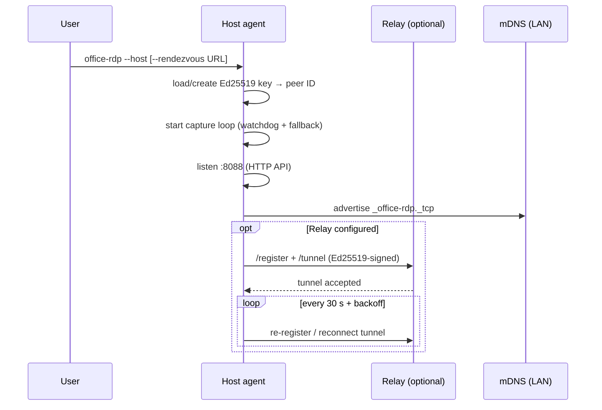
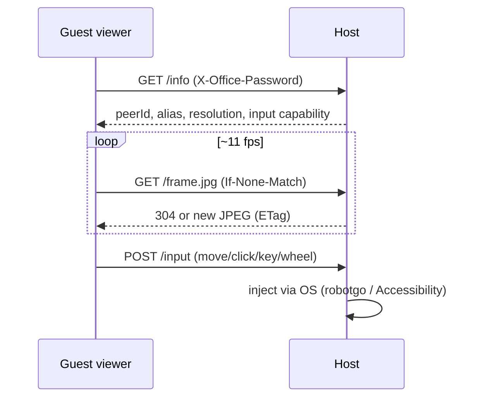
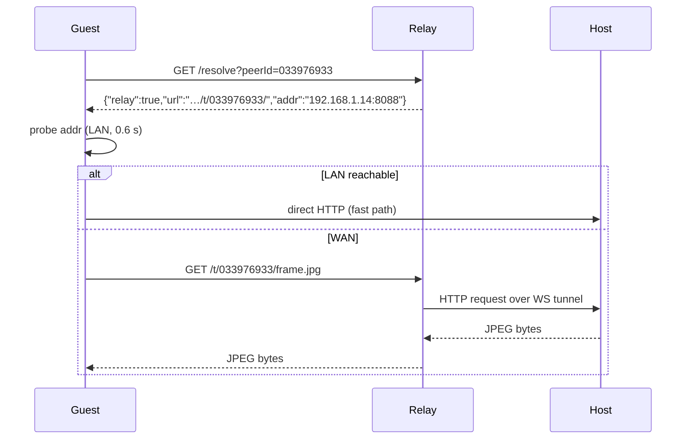
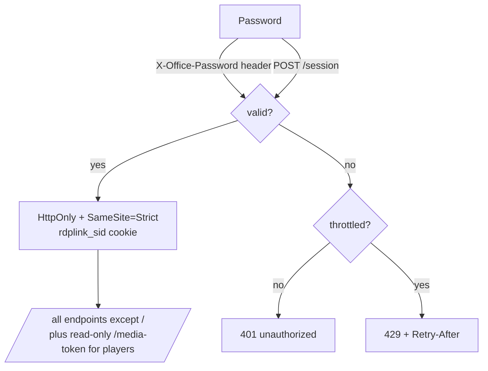
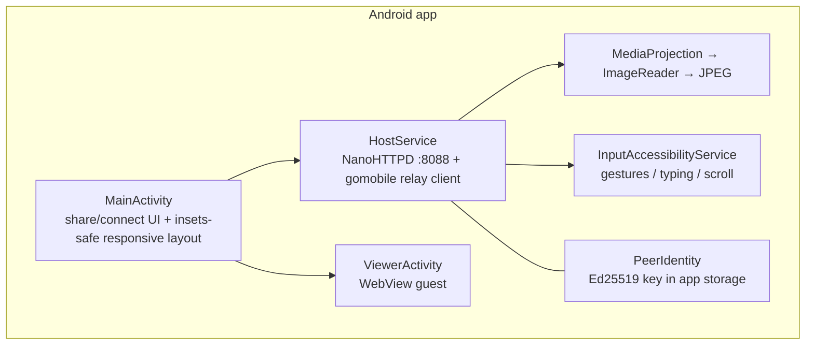
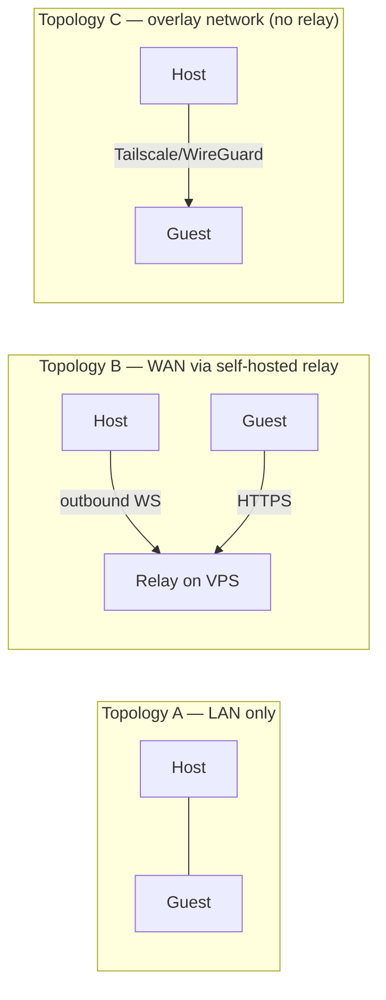

# RDP Link architecture

This document explains how the complete RDP Link system works end to end:
components, data flows, security model, and deployment topologies. Mermaid
diagrams render on GitHub and in most Markdown viewers.

- Version: 0.2.1 (see [`VALIDATION.md`](VALIDATION.md) for tested evidence)
- Protocol docs: [`HOST-AGENT.md`](HOST-AGENT.md) (HTTP API), [`WAN.md`](WAN.md)
  (relay), [`SECURITY.md`](SECURITY.md) (threat model)

---

## 1. Big picture

```mermaid
flowchart LR
    subgraph Guests
      D[Desktop viewer<br/>Python/Tk]
      W[Browser viewer<br/>viewer.html]
      A[Android viewer<br/>Kotlin]
      C[Headless CLI<br/>rdp-link]
    end

    subgraph "Host agent (office-rdp)"
      CAP[Screen capture<br/>SCK / CoreGraphics / X11 / GDI / MediaProjection]
      ENC[JPEG/PNG encoder +<br/>frame cache (ETag)]
      HTTP[HTTP server :8088]
      INJ[Input injector<br/>robotgo / AccessibilityService]
      CB[Clipboard]
      FILES[File transfer]
      DEV[Device bridge<br/>audio/camera/serial/ports]
    end

    RY[Rendezvous + relay<br/>office-rdp-rendezvous]

    D & W & A & C -- "LAN: HTTP/JPEG + /input" --> HTTP
    W & A & C -- "WAN: HTTPS /t/<peerId>/…" --> RY
    RY -- "outbound WebSocket tunnel" --> HTTP
    HTTP --> CAP & ENC & INJ & CB & FILES & DEV
```

- **Host** captures its own screen and serves it as adaptive JPEG frames over
  HTTP. Input events come back on `POST /input`.
- **Guests** are the desktop viewer, the built-in browser viewer, the Android
  app, or the headless CLI. Any modern browser works — no install needed.
- **Relay** exists only for WAN: the host dials it *outbound*; guests connect
  *to the relay*. See [`WAN.md`](WAN.md).

## 2. Components

| Component | Location | Role |
| --- | --- | --- |
| Host agent | `cmd/office-rdp` + `core/host` | capture, HTTP API, input, clipboard, files, device bridge, relay client |
| Rendezvous/relay server | `cmd/rendezvous` + `rendezvous` | peer registry, signed auth, reverse WebSocket tunnel, `/resolve`, `/t/<id>/` proxy |
| Desktop launcher/viewer | `app/` (Python/Tk) | launcher UI, Tk viewer, headless CLI (`rdp-link`) |
| Browser viewer + control panel | `core/host/viewer.html` + `/ui` | zero-install guest and host settings page |
| Android app | `android/` | host service (MediaProjection), viewer, accessibility-based input, relay via gomobile |
| Identity | `core/identity` | Ed25519 device key → 9-digit peer ID (`SHA-256(pubkey)`) |
| Relay monitor | `tools/relay-monitor` | tiny telemetry dashboard for a relay VPS |

## 3. Core workflows

### 3.1 Host startup



### 3.2 Guest connects — LAN



### 3.3 Guest connects — WAN (relay)



The host's public IP is never used, so dynamic IPs, CGNAT and firewalls do not
matter. The relay terminates TLS; run your own for privacy (see WAN.md §11).

### 3.4 Authentication flow



Credentials are evaluated **before** the throttle, so a client that knows the
password is never locked out by another client's bad guesses from the same IP.

### 3.5 Input injection

| Host OS | Mechanism | Permission |
| --- | --- | --- |
| macOS | robotgo (CoreGraphics events) | Accessibility |
| Linux (X11) | robotgo / X11 | none beyond display access |
| Windows | robotgo (SendInput) | — |
| Android | `InputAccessibilityService.dispatchGesture` | Accessibility service enabled |

Unknown input types return `400`; Android returns `503` when the accessibility
service is not bound, so a guest never believes an undelivered tap worked.

### 3.6 Clipboard, files and devices

- **Clipboard:** `GET/POST /clipboard` (text), cached ~500 ms to avoid spawning
  helper processes in a poll loop.
- **Files:** `GET /files`, `POST /upload`, `GET /download` with size limits and
  attachment headers; traversal-safe paths.
- **Device bridge:** `/audio` (Opus/WebM), `/mic`, `/camera.mjpg`,
  `/serial` (WebSocket), `/port/<p>/` allow-list proxy, `/usb/*` storage share.
  All require the same credential and origin checks; mic/serial are LAN-only
  over the relay.

## 4. Android architecture



- The host service runs as a foreground service with the
  `FOREGROUND_SERVICE_MEDIA_PROJECTION` type on Android 14+.
- The relay tunnel is opened by the **gomobile-bound Go client** (`mobile/`),
  so Android hosts work over WAN exactly like desktops.
- The UI uses shared card layouts + `values-sw360dp`/`sw600dp` resources and
  edge-to-edge insets so the same screen scales from small phones to tablets.

## 5. Identity and security model

| Layer | Mechanism |
| --- | --- |
| Device identity | Ed25519 key pair; peer ID = `SHA-256(pubkey)` formatted as 9 digits |
| Registry integrity | Every `/register`, `/tunnel`, `/peers` request is signed (method+URI+timestamp+body hash, 5-minute window, nonce replay protection) |
| Session | password → `POST /session` → HttpOnly cookie; cookie scoped per `/t/<peerId>/` on the relay |
| Credentials in URLs | never accepted (`?password=` → 401); `#pw=` fragment used only by the browser bootstrap and removed from the address bar |
| Media players | 2-minute read-only `?token=` limited to frame/audio/camera paths |
| Throttle | 20 failures/minute/IP → 429; correct credentials bypass the window |
| Origin | state-changing POSTs require same-origin headers; relay sets `X-Rdp-Relay-Secret` before trusting `X-Forwarded-For` |

## 6. Deployment topologies



Choose A for same-network, B for internet access without VPN, C when you want
full end-to-end encryption and already operate an overlay network.

## 7. Packaging and distribution

| Artifact | Built by | Contains |
| --- | --- | --- |
| DMG / PKG (macOS) | `packaging/build-macos*.sh` | `.app`, both-arch Go agents, CLI wrappers, TCC helper |
| NSIS `setup.exe` | `packaging/build-windows*` | launcher EXE, agent, rendezvous, PATH entry |
| `.deb` + tarball | `packaging/build-linux*.sh` | rdplink CLI, agent, rendezvous (amd64 + arm64) |
| APK / AAB | `packaging/build-android-release.sh` | Kotlin app + gomobile core, signed by the release key |
| Relay monitor | `tools/relay-monitor/` | single-file Python dashboard for a VPS |

Checksums for every artifact live in `releases/SHA256SUMS` and are regenerated
each release.

## 8. Failure handling, resilience and self-healing

- **Screen capture stall (macOS ScreenCaptureKit):** a 2 s watchdog switches
  the loop to the synchronous CoreGraphics path (`--capture-legacy` forces it);
  `--doctor` reports capture health with a deadline instead of hanging.
- **Viewer freezes:** if Tk cannot initialise, the launcher falls back to the
  browser viewer (`--tk-probe` preflight, `#pw=` fragment bootstrap).
- **Relay disconnects:** the host reconnects with exponential backoff; viewers
  retry automatically.
- **Throttling:** `429 + Retry-After` lets clients back off for exactly the
  right window; loopback clients hitting `adb forward` are identified by
  `X-Forwarded-For` only when the relay secret is present.
- **Android accessibility:** unbound service ⇒ `/input` 503 with a clear
  message; the app re-detects the bind and updates the status tag.

---

See also: [`WAN.md`](WAN.md) (relay operations), [`HOST-AGENT.md`](HOST-AGENT.md)
(HTTP API), [`TESTING.md`](TESTING.md) (how this is validated),
[`DEVELOPMENT.md`](DEVELOPMENT.md) (build & contribute).
