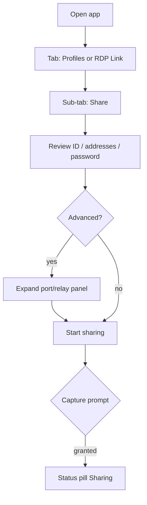
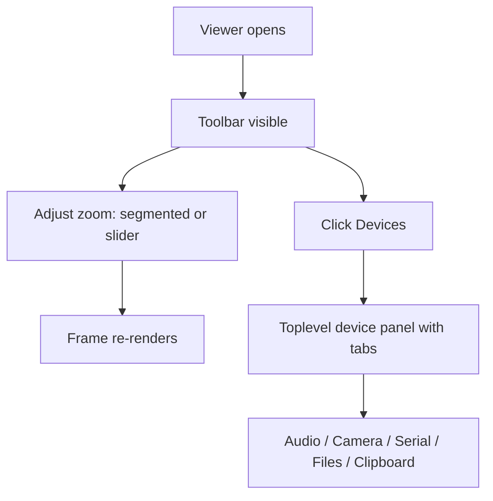

# RDP Link — Desktop (Tk) UI Enhancement Plan

> **Status:** Plan only. No code changes. Awaiting approval before implementation.
> Companion mockup: `docs/mockups/desktop-launcher.svg`.

## 0. Scope

Desktop app = Python/Tk launcher (`app/rdp_manager/ui/app.py`, `office_panel.py`,
`office_viewer.py`). Targets: macOS, Linux, Windows. Goal: bring the same
seamless, tabbed/expandable/popup/slider workflow already shipped for browser
and Android to the desktop, without changing the RDP profile workflow or the
host/viewer wire protocol.

## 1. Current desktop UI inventory

| Surface | File | Current layout |
|---|---|---|
| Launcher | `ui/app.py` | Header, footer action bar, `OfficePanel` (two cards), `Treeview` profile table |
| RDP Link panel | `ui/office_panel.py` | Two side-by-side cards (This device, Connect) with all fields inline |
| Viewer | `office_viewer.py` | Toolbar (chips), canvas, footer; zoom via Combobox; devices open in browser |
| Dialogs | `ui/dialogs.py`, `setup.py`, `editor.py` | Modal dialogs (already good) |

Pain points:
- All host fields (password, port, display, rendezvous, password regen) are inline
  in the "This device" card.
- RDP profiles table and RDP Link panel compete for vertical space.
- Viewer zoom is a dropdown only (no slider), and device control leaves the
  desktop app for the browser.
- No dark mode.

## 2. Proposed information architecture

### 2.1 Launcher — top-level `ttk.Notebook`

| Tab | Contents |
|---|---|
| **Profiles** | Existing `Treeview` profile table + footer actions (Connect/Edit/Delete) |
| **RDP Link** | `OfficePanel` reorganised into sub-tabs (see 2.2) |
| **Settings** | Permissions, receivers, preferences, dark mode toggle, about |

This keeps the profile workflow untouched while giving RDP Link its own space.

### 2.2 RDP Link panel — sub-tabs (`ttk.Notebook`)

| Sub-tab | Contents |
|---|---|
| **Share** | Peer ID, LAN/WAN, password (show/copy/new), display, status pill, Start/Stop sharing, advanced (port, rendezvous) behind an expandable panel |
| **Connect** | Address/peer ID, password, recent devices, resolve, pairing code, Wake on LAN, unattended |
| **Devices** | Audio/camera/serial/USB/ports status + toggles; quick links to viewer device panel |
| **Files** | Upload/download shortcuts, shared inbox hint |

### 2.3 Viewer

- Toolbar: brand, status pill, display picker, **zoom segmented control (Fit/Fill/1:1) + slider (50–150%)**, fullscreen, match window, devices, settings gear, disconnect.
- Bottom key bar becomes **collapsible** ("Keys" toggle) to reclaim space.
- Devices open in an in-app **Toplevel panel** with its own `ttk.Notebook` (Audio, Camera, Serial, Ports, USB, Files, Clipboard) instead of handing off to the browser.
- Settings gear opens a **popup** (Toplevel) with dark mode, quality, preferences.

## 3. Component mapping (Tk)

| Component | Tk implementation | Notes |
|---|---|---|
| Tabs | `ttk.Notebook` | Lazy tab content; remember last selected tab |
| Expandable panel | `ttk.Labelframe` inside a `tk.Frame` toggled by a button; animate via `after` height steps |
| Modal popup | `tk.Toplevel` with `transient` + `grab_set`; Esc to close |
| Slider | `ttk.Scale` (horizontal) with snap labels | maps to zoom percentage |
| Segmented control | `tk.Frame` of `Chip`-style labels | matches browser segmented control |
| Toast | existing status bar / `set_status` | reuse |
| Dark mode | switch root bg + ttk style colors via a theme function | store preference in `gui.json` |

## 4. UI workflow diagrams

### 4.1 Launcher share flow

### 4.2 Viewer zoom & devices

## 5. Migration plan (when approved)

Phase 1 — Launcher restructure (medium risk):
- Wrap existing `OfficePanel` in a `ttk.Notebook` (Share/Connect) with collapsible Advanced in Share.
- Keep profile table visible; do not move it yet.

Phase 2 — Top-level notebook (medium risk):
- Add top-level `ttk.Notebook` (Profiles / RDP Link / Settings).
- Move profile table into Profiles tab; move office panel into RDP Link tab.

Phase 3 — Viewer zoom slider + segmented control (low risk):
- Replace zoom Combobox with segmented + `ttk.Scale`; persist mode.

Phase 4 — Desktop device panel (high risk):
- Implement `Toplevel` device panel with tabs mirroring browser devices; migrate audio/camera/serial/file/clipboard actions from browser to Tk.

Phase 5 — Dark mode (medium risk):
- Add theme toggle in Settings; implement light/dark style switcher; persist preference.

Phase 6 — Tests:
- Update `tests/test_office_viewer.py` for zoom mode persistence.
- Add Tk smoke tests (`--tk-probe`) for new widgets.

## 6. What is NOT changing

- RDP profile schema and FreeRDP launch path.
- Host/viewer wire protocol.
- Existing config files (`gui.json`, `viewer.json`) — only additive keys.
- Keyboard/scroll warmup and permission flows.

## 7. Open questions

1. Should the profile table stay always visible (current) or move into a Profiles tab?
2. Should the device panel replace the browser hand-off entirely, or remain a fallback?
3. Dark mode in the same pass, or follow-up?

---

*Plan only. No code changes made.*