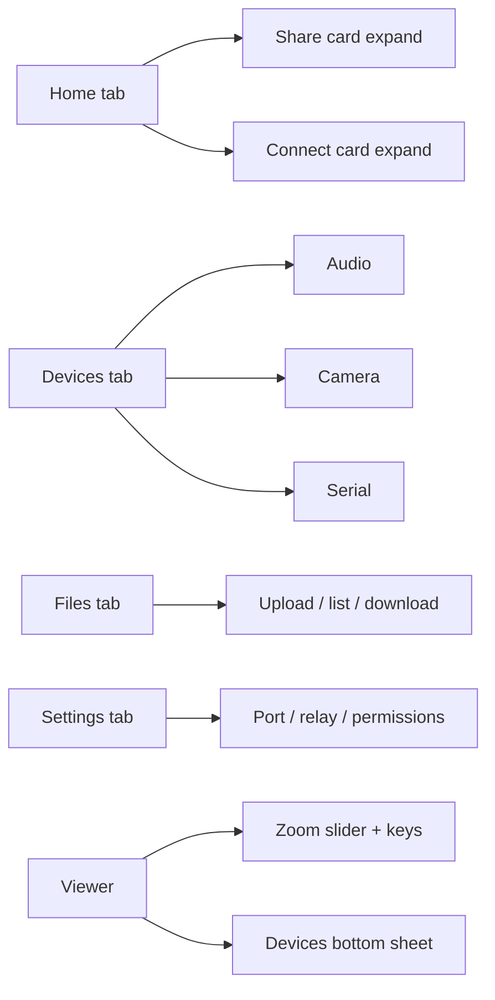

# RDP Link — Proposed Seamless UI Workflow

> **Status:** Proposal only. No code changes have been made. Awaiting approval
> before implementation. Companion mockups are in `docs/mockups/`.

## 0. Why this proposal

Today every surface (desktop control panel, browser viewer, Android app) puts
most features on a single scrolling screen or in one drawer. That works for a
handful of controls, but RDP Link now exposes many features per session:

- host identity (peer ID, LAN/WAN address, password)
- start/stop sharing, port, rendezvous relay
- permissions (accessibility, notifications, battery, screen capture)
- connect to another device, recent devices, peer-ID resolution
- viewer: zoom/scale, display picker, fullscreen, keyboard bar
- devices: speaker, microphone, camera (host + guest), serial, USB/IP, ports, clipboard, files

Stacking all of this makes the primary action (share / connect / view) hard to
find and increases scroll fatigue, especially on phones. This proposal
reorganises each surface around **tabs, expandable panels, modal popups and
sliders** while keeping the existing Ant Design 5 light tokens so the product
still looks like one thing across platforms.

---

## 1. Design principles

1. **One primary action per screen.** Share, Connect and View are never
   competing for the same vertical space.
2. **Progressive disclosure.** Advanced settings (port, relay, permissions)
   live behind an expandable section or a Settings tab, never inline by default.
3. **Tabs for parallel feature groups.** When a screen has 3+ unrelated groups,
   use tabs instead of a long scroll.
4. **Drawers/sheets for secondary flows.** Devices, files and clipboard open
   over the viewer instead of navigating away.
5. **Modals for destructive/one-shot actions.** Stop sharing, forget password,
   permission setup, text-to-type.
6. **Sliders for continuous values.** Zoom/scale and (future) quality/FPS use
   a slider with snap points, not a dropdown only.
7. **Bottom navigation on mobile, top tabs on desktop/browser.** Matches
   platform expectations.
8. **State survives navigation.** Tabs switch without losing in-progress input
   or the live remote frame.

---

## 2. Information architecture

### 2.1 Desktop / browser control panel (`ui.html`)

Current: two cards stacked (This device, Connect to a device) + advanced panel.

Proposed top-level tabs:

| Tab | Contents |
|---|---|
| **Share** | Peer ID, LAN/WAN, password (show/copy), status pill, Start/Stop sharing, recent share sessions |
| **Connect** | Address/ID input, password, recent devices (tappable, long-press remove), resolve 9-digit ID |
| **Devices** | Only meaningful while hosting/viewing locally: audio, camera, serial, ports, USB, clipboard, files (links to viewer drawer) |
| **Settings** | Port, rendezvous relay URL, permissions status, display scaling defaults, about |

Advanced fields (port, relay) move into **Settings** tab; permissions become a
modal "Setup & permissions" popup reachable from Settings and from a header
status pill.

### 2.2 Browser viewer (`viewer.html`)

Current: full-screen frame + header toolbar + devices drawer + bottom key bar.

Proposed:

- **Header toolbar** (always visible): brand, status pill, display picker,
  zoom slider (50–150% with snap: 50/75/100/125/150 + Fit/Fill), fullscreen,
  devices button, clipboard, disconnect.
- **Main stage**: remote frame (unchanged).
- **Bottom key bar**: compact, hideable, with a "more keys" expandable.
- **Devices drawer** becomes a **right sheet with internal tabs**:
  Audio, Camera, Serial, Ports, USB, Files, Clipboard. Only tabs whose
  `/capabilities` are enabled are shown.
- **Connect overlay** stays a centered modal popup (password entry).
- **Settings popover** from a gear icon: quality/FPS target, cursor mode,
  keyboard layout, "Match window".

### 2.3 Android app

Current: single scroll with Share card + Connect card + collapsed advanced panel
+ sticky action bar.

Proposed:

- **Bottom navigation bar** (4 tabs): Home, Devices, Files, Settings.
- **Home tab** = two stacked cards but each is an **expandable** accordion:
  - "Share this screen" (collapsed summary shows status + peer ID)
  - "Connect to a device" (collapsed summary shows last target)
  - Primary action buttons move into each card (Share/Stop, Connect) instead of
    one shared sticky bar.
- **Devices tab** = list of device bridges with toggle rows + expandable detail
  (speaker play/stop, mic start/stop, camera preview, serial console).
- **Files tab** = upload/refresh + file list (moved out of the devices drawer).
- **Settings tab** = port, relay URL, permissions checklist (as expandable rows
  with status tags), advanced toggles.
- **Popups**: permission setup stays a modal dialog; "New password" confirmation;
  destructive actions (stop sharing, remove recent) use confirmation dialogs.
- **Sliders**: in the viewer, pinch-to-zoom plus a floating zoom slider;
  optional "quality" slider in Settings.

### 2.4 Desktop (Tk) launcher/viewer

The Tk app mirrors the browser IA: a `ttk.Notebook` (tabs) for Share/Connect/
Devices/Settings in the launcher, and the viewer keeps its toolbar + a tabbed
side panel. Expandables use collapsible `Labelframe`s.

---

## 3. Component additions (design tokens unchanged)

| Component | Where | Behaviour |
|---|---|---|
| **Tabs** (top) | desktop/browser control panel, viewer drawer | Ant Design `Tabs` look: 40 px tab bar, blue active indicator, lazy content |
| **Bottom nav** | Android | 4 items, icon + label, active colour primary |
| **Accordion / expandable card** | Android Home, Settings | chevron toggle, animated height, remembers open state |
| **Modal popup** | all | centered card, scrim, Esc/back to close, focus trap |
| **Bottom sheet** | Android | slides up for device actions and "more keys" |
| **Slider** | viewer zoom, quality | 4 px track, 12 px thumb, snap points, value tooltip |
| **Toast** | all | unchanged |
| **Segmented control** | zoom Fit/Fill/1:1 | compact alternative to slider snaps |
| **Chip** | recent devices, tags | tappable, removable |

All new components reuse the existing colour/spacing/radius tokens from
`docs/UI-DESIGN.md` §1, so no new palette is introduced.

---

## 4. UI workflow diagrams

### 4.1 Host: start sharing

```mermaid
flowchart TD
    A[Open app / control panel] --> B{Tab: Share}
    B --> C[Review Peer ID / addresses / password]
    C --> D[Adjust advanced?]
    D -- yes --> E[Tab: Settings → port/relay/permissions]
    E --> F[Back to Share]
    D -- no --> F
    F --> G[Click Start sharing]
    G --> H{Screen capture prompt}
    H -- denied --> I[Toast error, stay on Share]
    H -- granted --> J[Status pill = Sharing (green)]
    J --> K[Guests connect with ID or address]
```

### 4.2 Guest: connect and view

```mermaid
flowchart TD
    A[Open app / control panel] --> B{Tab: Connect}
    B --> C[Enter address or 9-digit ID]
    C --> D{9-digit ID?}
    D -- yes --> E[Resolve via rendezvous URL]
    D -- no --> F[Open viewer with address]
    E --> F
    F --> G[Viewer opens, password modal]
    G --> H{Password OK?}
    H -- no --> G
    H -- yes --> I[Live remote frame]
    I --> J[Use toolbar: zoom slider, display, fullscreen]
    I --> K[Open Devices sheet (tabs)]
    K --> L[Audio / Camera / Serial / Files / Clipboard]
```

### 4.3 Android navigation



### 4.4 Permission setup popup flow

```mermaid
flowchart TD
    A[Settings → Permissions row] --> B[Open modal "Setup & permissions"]
    B --> C{Accessibility enabled?}
    C -- no --> D[Open system settings]
    C -- yes --> E{Notifications granted?}
    D --> E
    E -- no --> F[Request permission]
    E -- yes --> G{Battery exempt?}
    F --> G
    G -- no --> H[Open battery settings]
    G -- yes --> I[All ready tag]
    H --> I
```

---

## 5. Screen-by-screen proposal (with mockups)

### 5.1 Desktop / browser control panel

Mockup: `docs/mockups/desktop-control-panel.svg`

- Header: brand + status pill + "Open viewer" (hosting) action.
- Top tabs: Share / Connect / Devices / Files / Settings.
- Share tab card: identity block (peer ID, LAN, WAN, password) + status + Start/Stop.
- Connect tab: address input, password, recent devices list, resolve hint.
- Settings tab: port, relay URL, permissions modal trigger, defaults.

### 5.2 Browser viewer

Mockup: `docs/mockups/browser-viewer.svg`

- Header toolbar with zoom **slider** (replacing pure dropdown; dropdown kept as
  fallback for keyboard users) and display picker.
- Devices opens as a right sheet with **tabs** (Audio, Camera, Serial, Ports,
  USB, Files, Clipboard).
- Connect password stays a **modal popup**.
- Bottom key bar collapsible ("More keys" expandable).

### 5.3 Android home

Mockup: `docs/mockups/android-home.svg`

- Header with peer ID + copy.
- Bottom navigation: Home / Devices / Files / Settings.
- Home has two **expandable** cards (Share, Connect) + status tag.
- Share/Connect actions inside their cards; no single shared sticky bar on Home.
  (Viewer keeps its own action bar.)
- Settings tab holds permissions as expandable rows with status tags.

---

## 6. Migration plan (when approved)

Phase 1 — Browser control panel (`ui.html`): introduce tabs + Settings tab;
move advanced fields. Low risk, single file.

Phase 2 — Browser viewer (`viewer.html`): zoom slider, tabbed devices sheet,
settings popover, collapsible key bar.

Phase 3 — Android: bottom navigation + fragment/tab structure, expandable
cards, move Files to its own tab, permissions rows. Requires Kotlin + layout
changes; keep existing IDs to minimise logic churn.

Phase 4 — Desktop Tk: `ttk.Notebook` tabs mirroring browser IA; collapsible
frames for advanced.

Phase 5 — Docs: update `UI-DESIGN.md` §4 with new component specs; add
accessibility notes for tabs/sheets.

Each phase ships behind the existing visual tokens; no colour/spacing change.

---

## 7. Open questions for approval

1. Tab order on desktop: **Share, Connect, Devices, Files, Settings** (proposed)
   or **Connect first** for guest-heavy usage?
2. Android bottom nav: 4 tabs (Home/Devices/Files/Settings) or 5 (add Viewer)?
3. Zoom control: slider + segmented (Fit/Fill/1:1) together, or slider only?
4. Should "Devices" tab exist on Android Home as a separate tab, or keep the
   devices sheet inside the viewer only?
5. Do you want dark mode added in the same pass, or keep light-only?

---

## 8. What is NOT changing

- Ant Design 5 light tokens, spacing scale, radii, shadows.
- Host/viewer wire protocol and endpoints.
- Keyboard shortcuts and touch input behaviour.
- Existing recent-devices storage format.

---

*No code has been modified. This document and the mockups under
`docs/mockups/` are the only artefacts produced.*