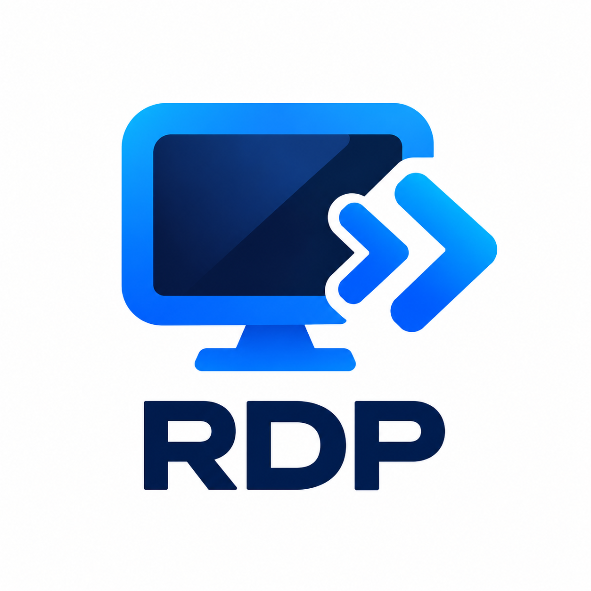

<p align="center">
  
</p>

<h1 align="center">RDP Link</h1>

<p align="center">
  <strong>Self-hosted, cross-platform remote desktop for macOS, Linux, Windows and Android.</strong><br/>
  Share a screen, control another machine, move files and forward devices — over your LAN or your own relay.
</p>

<p align="center">
  Built and maintained by
  <a href="https://www.eminentailabs.com"><strong>Eminent AI Labs Pvt. Ltd.</strong></a>
</p>

<p align="center">
  <a href="LICENSE"></a>
  
  
</p>

<p align="center">
  <a href="#downloads">⬇ Downloads</a> ·
  <a href="#installation">Installation</a> ·
  <a href="#usage">Usage</a> ·
  <a href="#headless-cli-no-gui-needed">CLI</a> ·
  <a href="#wan-remote-access-dynamic-ips">WAN</a> ·
  <a href="#security--privacy">Security</a>
</p>

---

RDP Link connects two devices directly, or through a rendezvous/relay server
you run yourself. A host agent captures the screen and serves it as JPEG
frames over HTTP; guests render those frames, send input events back, and
optionally use clipboard, file transfer, audio, camera, serial and TCP port
forwarding.

It is deliberately simple to deploy: a single Go binary on the host, a browser
or a small desktop app on the guest, and no cloud account. It is **not** a
Microsoft RDP server and does not implement the RDP wire protocol — the name
refers to the product, not to Microsoft's protocol.

## Supported platforms

| Platform | As a Host (share screen) | As a Guest (control) |
| --- | --- | --- |
| **macOS** (Apple Silicon + Intel) | ✅ Full capture + input | ✅ Desktop app / browser |
| **Linux** (Ubuntu/Debian, X11) | ✅ Full capture + input | ✅ Desktop app / browser |
| **Windows** 10/11 | ✅ Host agent (buildable) | ✅ Desktop app / browser |
| **Android** 10+ (API 29+) | ✅ MediaProjection + accessibility | ✅ Full-screen app |
| **Any modern browser** | — | ✅ No install required |

## Downloads

Click a link to download v0.2.0 directly. All files ship from this repository's
[`RDP_Link_v2/releases/`](RDP_Link_v2/releases/) folder, and every file has a
checksum in [`SHA256SUMS`](RDP_Link_v2/releases/SHA256SUMS).

| OS | Direct download | Type | Size | SHA-256 (first 16) |
| --- | --- | --- | --- | --- |
| **macOS** — app (Apple Silicon + Intel) | ⬇ [RDPLink-macos.dmg](RDP_Link_v2/releases/RDPLink-macos.dmg) | DMG image | 46 MB | `8ed74c50cf44a1f5` |
| **macOS** — installer (adds CLI + service) | ⬇ [RDPLink-installer.pkg](RDP_Link_v2/releases/RDPLink-installer.pkg) | PKG installer | 41 MB | `3cf9de56c26fb1a3` |
| **Windows** 10/11 (x86-64) | ⬇ [RDPLink-setup.exe](RDP_Link_v2/releases/RDPLink-setup.exe) | NSIS installer | 22 MB | `a5d0fa6d4c455252` |
| **Linux** x86-64 | ⬇ [rdplink-linux-amd64.deb](RDP_Link_v2/releases/rdplink-linux-amd64.deb) | Debian package | 24 MB | `834dfc67f6673bf4` |
| **Linux** ARM64 | ⬇ [rdplink-linux-arm64.deb](RDP_Link_v2/releases/rdplink-linux-arm64.deb) | Debian package | 23 MB | `d1fcc1af58b265f8` |
| **Linux** — portable (both arches) | ⬇ [rdplink-linux.tar.gz](RDP_Link_v2/releases/rdplink-linux.tar.gz) | Tarball | 74 MB | `ad939773fc4878e9` |
| **Android** 10+ — phone/tablet | ⬇ [RDPLink-android-release.apk](RDP_Link_v2/releases/RDPLink-android-release.apk) | APK (sideload) | 49 MB | `be3579fc484d1761` |
| **Android** — Play Console | ⬇ [RDPLink-android-release.aab](RDP_Link_v2/releases/RDPLink-android-release.aab) | App bundle | 19 MB | `2e026d69ae006fc4` |

> **Verify before installing:**
> `shasum -a 256 <file>` (macOS/Linux) and compare with the checksum file.

## Installation

### macOS — DMG (most users)

1. Download and open `RDPLink-macos.dmg`.
2. Drag **RDP Link** to **Applications**.
3. First run: right-click → **Open** (unsigned/ad-hoc build), then approve
   *Screen Recording* and *Accessibility* when prompted.

### macOS — PKG (adds CLI, firewall rule, login service)

```sh
sudo installer -pkg RDPLink-installer.pkg -target /
```

The postinstall writes `/usr/local/bin/rdp-link` and a firewall allow rule.

### Windows

1. Download and run `RDPLink-setup.exe` → Next → Finish.
2. Use the Start Menu shortcut, or `rdp-link.exe` in a terminal
   (`C:\Program Files\RDP Link` is added to `PATH`).

### Linux — `.deb`

```sh
sudo dpkg -i rdplink-linux-amd64.deb      # or rdplink-linux-arm64.deb
rdp-link --help                            # CLI installed to /usr/bin
```

### Linux — portable tarball

```sh
tar xzf rdplink-linux.tar.gz && cd rdplink-linux
./rdp-link            # launcher
./office-rdp --host   # host agent
./office-rdp-rendezvous  # relay server
```

### Android

1. Download `RDPLink-android-release.apk` on the phone.
2. Allow **Install unknown apps** for your browser/file manager, then install.
3. Open **RDP Link** → grant *Screen capture* when starting a share, and enable
   the **RDP Link accessibility service** for remote control.

## Usage

### Share this screen (host)

| Platform | Steps |
| --- | --- |
| macOS/Linux/Windows | `office-rdp --host --port 8088` (or click **Start sharing** in the app) |
| Android | Open **RDP Link**, tap **Start sharing**, approve the capture prompt |
| Headless (no GUI) | `rdp-link --share --port 8088` |

The host prints a 9-digit **peer ID** and its LAN address.

### Connect (guest)

| Guest | How |
| --- | --- |
| Browser | `http://HOST:8088/` → enter the host password |
| Desktop app | Enter `HOST:8088` (or the peer ID for WAN) → **Connect** |
| Android app | Enter `HOST:8088` (or the peer ID) → **Connect** |

Guests can view the screen, click/type, sync the clipboard and move files.

### Headless CLI (no GUI needed)

Every desktop package ships the `rdp-link` CLI, which works over SSH and in
containers — no display server, no tkinter.

**CLI installation**

| Platform | How the CLI gets on PATH |
| --- | --- |
| macOS `.pkg` | `/usr/local/bin/rdp-link` is added by the installer postinstall |
| macOS `.dmg` | `"RDP Link.app/Contents/MacOS/rdp-link" --install-cli` links it to `/usr/local/bin` |
| Windows | Installer adds `C:\Program Files\RDP Link` to `PATH` |
| Linux `.deb` | Installed to `/usr/bin/rdp-link` |
| Linux tarball | Run `./rdp-link` from the extracted folder |

**Common commands**

```sh
rdp-link --id                                   # your 9-digit peer ID
rdp-link --status                               # is anything running / reachable?
rdp-link --share --port 8088                    # start hosting, no GUI
rdp-link --connect HOST:8088 --probe            # check a host, print frame size
rdp-link --connect HOST:8088 --save-frame shot.jpg
rdp-link --connect HOST:8088 --clipboard-get
rdp-link --connect HOST:8088 --clipboard-set "hello"
rdp-link --connect HOST:8088 --type "text" --click 120,80
rdp-link --connect 123456789 --rendezvous https://relay.example.com
```

Run `rdp-link --help` for the full list (peers, displays, recordings and more).
Details: [`RDP_Link_v2/README.md`](RDP_Link_v2/README.md#headless-cli-no-gui).

## WAN (remote access, dynamic IPs)

The host never needs a public IP. It derives a stable 9-digit peer ID from its
Ed25519 device key and keeps an **outbound** WebSocket tunnel open to the
relay; guests connect via the relay's stable URL. If the host's IP changes, it
reconnects automatically.

```sh
# 1. On your relay server (see RDP_Link_v2/docs/WAN.md §11)
office-rdp-rendezvous --listen :443 --tls-cert CERT --tls-key KEY \
  --public-url https://relay.example.com

# 2. On the host
office-rdp --host --port 8088 --rendezvous https://relay.example.com

# 3. On the guest
rdp-link --connect 123456789 --rendezvous https://relay.example.com
```

Full walkthrough (WAN model, Oracle Cloud $0 deployment, resource sizing, free
alternatives): [`RDP_Link_v2/docs/WAN.md`](RDP_Link_v2/docs/WAN.md).

> **Public relay (best effort):** a convenience relay is available at
> `https://relay.130-210-56-200.sslip.io`. It is run by the maintainer on a
> best-effort basis and may change or be removed at any time — no uptime or
> availability is guaranteed. Use it at your own risk; self-host for production.
>
> **Server monitor:** `https://monitor.130-210-56-200.sslip.io` shows the
> relay host's health and resources (password-protected; see WAN.md §12).

## Security & privacy

- Host password header or `HttpOnly`, `SameSite=Strict` session cookie;
  brute-force throttling (`401` → `429` with `Retry-After`).
- Rendezvous registration is Ed25519-signed — nobody can hijack a peer ID.
- No analytics, no telemetry, no cloud account. The relay sees traffic
  (TLS-terminated), so self-host it for privacy-sensitive use.
- Details: [`RDP_Link_v2/docs/SECURITY.md`](RDP_Link_v2/docs/SECURITY.md),
  [`RDP_Link_v2/docs/PRIVACY.md`](RDP_Link_v2/docs/PRIVACY.md).

## Documentation

Full index: [`RDP_Link_v2/docs/README.md`](RDP_Link_v2/docs/README.md).

| Document | Contents |
| --- | --- |
| [`RDP_Link_v2/docs/ARCHITECTURE.md`](RDP_Link_v2/docs/ARCHITECTURE.md) | Complete system design — components, workflows with diagrams, security model, deployment topologies |
| [`RDP_Link_v2/docs/DEVELOPMENT.md`](RDP_Link_v2/docs/DEVELOPMENT.md) | Dev environment, building every platform, test gates, contribution rules |
| [`RDP_Link_v2/docs/WAN.md`](RDP_Link_v2/docs/WAN.md) | Relay operations: WAN model, dynamic IPs, VPS deployment, resource sizing, free alternatives, telemetry monitor |
| [`RDP_Link_v2/docs/HOST-AGENT.md`](RDP_Link_v2/docs/HOST-AGENT.md) | Host runner + full HTTP API reference |
| [`RDP_Link_v2/docs/SECURITY.md`](RDP_Link_v2/docs/SECURITY.md) / [`PRIVACY.md`](RDP_Link_v2/docs/PRIVACY.md) | Threat model and data handling |
| [`RDP_Link_v2/docs/TESTING.md`](RDP_Link_v2/docs/TESTING.md) / [`VALIDATION.md`](RDP_Link_v2/docs/VALIDATION.md) | How the product is validated and the hardware evidence |
| [`RDP_Link_v2/docs/adr/`](RDP_Link_v2/docs/adr/) | Architecture decision records |
| [`RDP_Link_v2/docs/RELEASING.md`](RDP_Link_v2/docs/RELEASING.md) | Release checklist and packaging |

## Repository layout

```
RDP_Link_v2/      # Current product: host agent, launcher, Android app, relay,
                  # docs, packaging, releases — see RDP_Link_v2/README.md
rdp_manager/      # Legacy FreeRDP/xrdp launcher (superseded, kept for reference)
receiver/         # Legacy host-side audio/camera receivers
docs/             # Legacy docs (current docs live in RDP_Link_v2/docs)
```

## License

MIT — see [`LICENSE`](LICENSE). RDP Link is free and open source: fork, audit,
self-host and redistribute under the license terms.

---

© Eminent AI Labs Pvt. Ltd. · [www.eminentailabs.com](https://www.eminentailabs.com)
